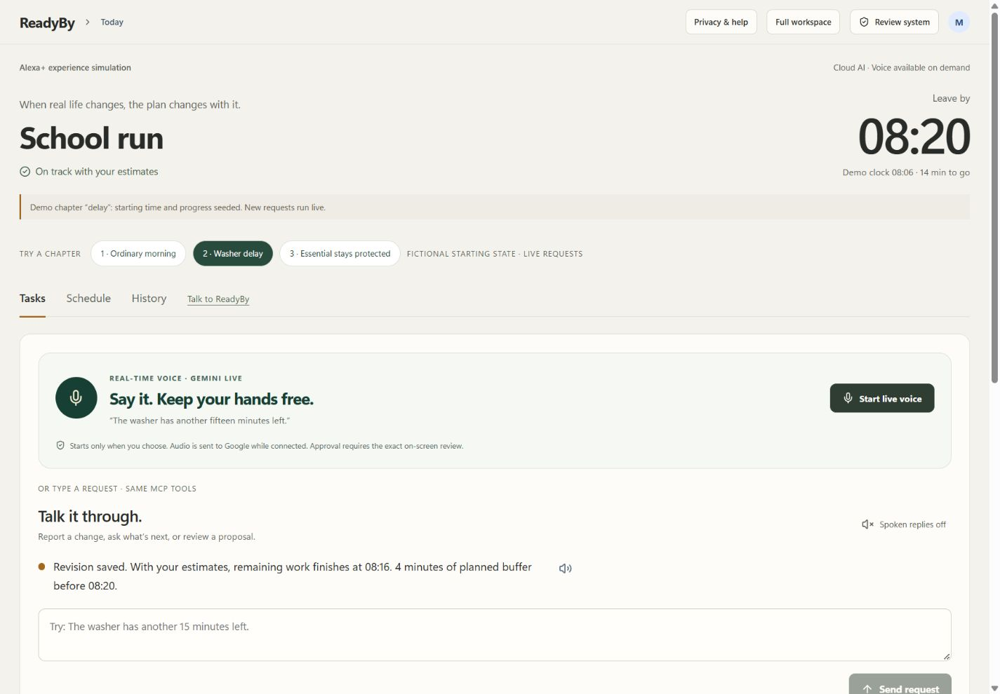
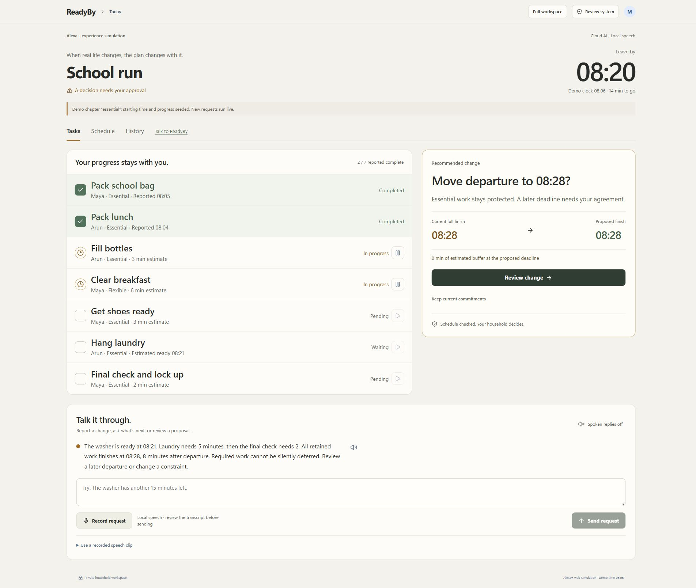
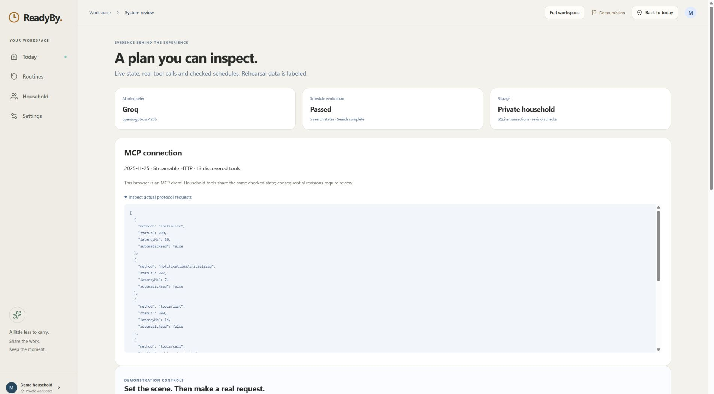
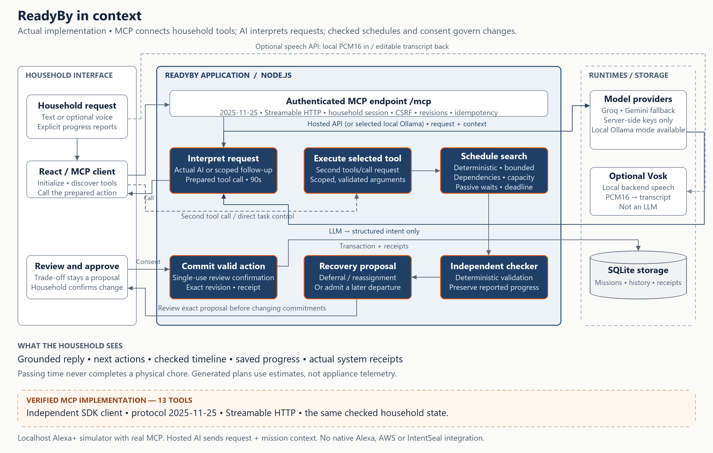

<div align="center">

<picture>
  <source media="(prefers-color-scheme: dark)" srcset="docs/brand/readyby-logo-dark.svg">
  
</picture>

### A shared deadline. A plan that adapts.

**Tell ReadyBy what changed. Review a checked recovery. Keep the household moving.**

[](https://github.com/sankalp2515/ReadyBy/actions/workflows/ci.yml)
[](https://github.com/sankalp2515/ReadyBy/releases)
[](LICENSE)
[](package.json)
[](docs/MCP.md)

[Live demo](https://34-10-147-168.sslip.io/) · [Quick start](#quick-start) · [Try the scenario](#try-the-recovery) · [Architecture](docs/architecture/README.md) · [MCP tools](docs/MCP.md) · [Evidence](docs/READYBY_MCP_VERIFICATION.md) · [Release](https://github.com/sankalp2515/ReadyBy/releases/tag/v0.4.0)



<sub>Actual captured product state. The labelled school-run fixture seeds time and reported progress; subsequent requests use the real model and household tools.</sub>

</div>

---

## Why ReadyBy

Getting everyone out of the house is more than remembering a list. Two people share the work, one chore waits for another, and a washer can keep running while someone packs lunch. When an estimate changes, somebody has to rebuild the morning in their head.

ReadyBy maintains that shared plan. It models active effort, passive waits, prerequisites and each person's availability, then checks what can still finish before departure. **Completed work stays completed. Essential work stays protected. Changed commitments wait for review.**

| School-run fixture | Computed result |
| --- | --- |
| Seven tasks, two adults, departure at **08:20** | Original plan finishes **08:19**. |
| At labelled 08:06, the washer has another 15 minutes left | Full plan finishes **08:28**. |
| Household reviews and approves saving flexible laundry for later | Remaining departure work finishes **08:16**; laundry remains unfinished. |
| Laundry is essential instead | Deferral is unavailable; a later departure needs agreement. |

These are calculations from editable estimates, not measured time savings. Time passing never marks a physical chore complete.

## What is real

ReadyBy **0.4.0** is a working Alexa+ web simulator with a self-hosted MCP server, not a native Echo integration.

| Component | Implemented behavior |
| --- | --- |
| MCP | Official TypeScript SDK; protocol **2025-11-25**; Streamable HTTP; **13 tools**. Both the browser and an independent CLI are actual MCP clients. |
| Language interpretation | Server-side Groq or Gemini, configurable NVIDIA adapter, or local Ollama. Receipts retain actual provider/model, attempts, latency and normalized intent. |
| Planning | Deterministic bounded search plus an independent schedule checker. The LLM does not calculate authoritative feasibility. |
| Consent | Saying “yes” opens review. Committing requires a short-lived, single-use confirmation for the exact proposal and revision. |
| State | Household-scoped SQLite transactions, revision checks, idempotent requests, history and preserved reported progress. |
| Interface | Product landing page with computed examples, guided chapters, voice-first household display, editable routines and inspectable system review. |
| Live voice | Gemini Live bidirectional audio, interruptible playback, captions, explicit microphone controls and short-lived browser credentials. Heard requests use the same real MCP tools. [Voice architecture](docs/LIVE_VOICE.md). |
| Optional recorded speech | Vosk recognition on the ReadyBy server with transcript review; browser-installed voices for typed replies. |

The public judge beta runs on Google Cloud with HTTPS and persistent SQLite. Native Alexa account linking, appliance sensors, push notifications and AWS integration are not included. This is an independent Alexa+ simulation, not a certified Alexa add-on.

## Quick start

Requires **Node.js 22.20+**, **pnpm 11.25.0** and a modern browser. Node's built-in SQLite may emit an experimental warning.

```bash
git clone https://github.com/sankalp2515/ReadyBy.git
cd ReadyBy
pnpm install --frozen-lockfile
pnpm build
node app-server.mjs
```

Open **http://127.0.0.1:4173** and choose **Try the live demo**. Task controls and the typed MCP demo work without a model or provider key.

For actual conversation, choose a model configuration below. Node loads `.env` automatically; shell settings take precedence. **Never commit your real `.env`.**

<details>
<summary><b>Hosted AI — Groq, optional Gemini fallback</b></summary>

Create `.env` with your own server-side credentials:

```dotenv
READYBY_AI_PROVIDER=groq
GROQ_API_KEY=replace_with_your_key
READYBY_GROQ_MODEL=openai/gpt-oss-120b
READYBY_AI_FALLBACKS=gemini
GEMINI_API_KEY=replace_with_your_optional_fallback_key
READYBY_GEMINI_MODEL=gemini-3.1-flash-lite
```

Remove the fallback settings if you do not have a Gemini key. Restart the server after changing configuration. Hosted inference sends the request and bounded task/person context to the actual provider. Quota, terms and billing apply. Permanent keys never reach the browser. Live voice streams audio to Google using a one-use ephemeral credential; recorded transcription runs on the ReadyBy server. A Gemini key is required for live voice even when typed interpretation uses another provider.

</details>

<details>
<summary><b>Local AI — Ollama, no hosted key</b></summary>

Install [Ollama](https://ollama.com/), start its service and obtain the documented model:

```bash
ollama pull llama3:8b-instruct-q4_K_M
```

Set in `.env`:

```dotenv
READYBY_AI_PROVIDER=ollama
READYBY_MODEL=llama3:8b-instruct-q4_K_M
READYBY_OLLAMA_URL=http://127.0.0.1:11434
```

This disables hosted fallback. Approximately 5 GB of model weights are not bundled; hardware and model-license requirements apply. If inference is unavailable, conversation reports that condition and direct controls remain usable.

</details>

<details>
<summary><b>Optional local speech</b></summary>

```bash
python scripts/setup-speech.py
node app-server.mjs
```

Tested with Python 3.12 on Windows. Setup creates an isolated environment and downloads a checksum-verified Vosk English model. Select **Record request**, stop, review/edit the transcript, then send. Spoken replies start off. Raw audio is not saved by the application. Human microphone accuracy and voice quality require your own rehearsal.

</details>

For live voice, add a funded `GEMINI_API_KEY`, restart, choose **Start live voice** and allow microphone access. HTTPS or localhost is required; no wake word is used. Changes to commitments still require exact on-screen approval.

Detailed configuration, accounts, backups and speech: [setup guide](docs/SETUP.md).

## Try the recovery

1. Explore a private demo. The opening plan checks **08:19** for an **08:20** departure.
2. In **Review system**, choose **2 · Washer disruption**. This explicitly seeds 08:06 and reported bag/lunch completion; it does not fabricate a model response.
3. Return to the household display. Enter **“The washer needs more time.”** When asked, answer **“Fifteen minutes.”** The scoped follow-up avoids another model call.
4. Inspect full finish **08:28** and the proposed **08:16** recovery. Say **“Yes.”** Review opens; the proposal has not been applied.
5. Confirm **Approve this revision**. Laundry becomes deferred and unfinished. Completed reports and the 08:20 departure remain intact. Reload to inspect saved state.
6. In a separate labelled **Essential laundry** chapter, report the same delay. The system must acknowledge the conflict rather than defer essential work.

<table>
<tr>
<td width="50%"><br><sub><b>Protect essentials, even when the deadline cannot work.</b></sub></td>
<td width="50%"><br><sub><b>Inspect the real protocol and provider evidence.</b></sub></td>
</tr>
</table>

[Demo runbook](docs/READYBY_DEMO_RUNBOOK.md) · [83.5-second narrated evidence walkthrough](https://github.com/sankalp2515/ReadyBy/releases/download/v0.3.0/readyby-mcp-evidence-walkthrough.mp4)

The walkthrough uses actual captured states and is explicitly labelled as not a continuous recording. It does not show the complete live conversation. A final public submission video is separate.

## Architecture

<div align="center"></div>

1. **Interpret.** A real model extracts a constrained intent; semantic validation asks for missing information instead of guessing.
2. **Prepare and execute.** The interpretation tool returns a short-lived call bound to session, household, mission, revision and arguments. The MCP client invokes the selected typed tool.
3. **Calculate and check.** Deterministic planning creates proposals, and a separate checker validates dependencies, capacity and deadlines.
4. **Review and persist.** Exact-proposal confirmation authorizes consequential changes; transactions preserve state and receipts.

The current bounds are one or two adults, up to eight tasks and integer-minute estimates. Search limits can produce uncertainty. The first-party review/session is trusted; its confirmation token is not cryptographic proof of human presence. [Architecture and source map](docs/architecture/README.md)

## Use the MCP server

With the application running, open another terminal:

```bash
node scripts/mcp-demo.mjs          # typed tools; no LLM request
node scripts/mcp-demo.mjs --live   # actual configured inference; consumes quota
```

These official-SDK clients create private demo sessions, initialize, list tools and exercise checked recovery, scripted confirmation and essential-task protection. The endpoint is **`/mcp`**, authenticated with the household session and CSRF header. It is not an anonymous endpoint or native Alexa OAuth service. [Tool catalogue, authentication and examples](docs/MCP.md)

## Evidence and verification

```bash
node --test
pnpm typecheck
pnpm build
```

Tests use provider doubles and do not require secrets. Live provider reports are separate from automated tests.

| Evidence | Recorded result | Limit |
| --- | --- | --- |
| 0.4 automated suite | **64/64 tests**, typecheck and build passed | Includes live credential/auth/quota, preview, provider response failure and consent navigation coverage. |
| Hosted voice integration | Synthetic audio → actual transcript → MCP → Groq → checked state → spoken Gemini reply | Engineering check; human microphone and noisy-room quality remain unmeasured. [Evidence](docs/READYBY_0_4_VERIFICATION.md). |
| 0.3 isolated source export | **56/56 tests**, typecheck and production build passed | Same Windows host; not a second physical-machine test. CI also checks the published source. |
| Selected hosted pipeline | **30/30** development utterances; **1,047 ms** median, **3,821 ms** p95 | Prompt-informed corpus, including validation/normalization; not a held-out benchmark. |
| Actual browser interpretation | **947 ms** missing-duration turn; **612 ms** natural consent turn | Individual observations, not latency guarantees. |
| Independent SDK client | Protocol negotiated, **13 tools**, checked recovery and essential protection | CLI confirmation is scripted, not human approval evidence. |
| Browser persistence and layout | Reload/restart and desktop/phone checks passed | Human microphone quality, production load and customer adoption remain unmeasured. |

Earlier provider failures are retained alongside the final reports. [Method, raw evidence and limitations](docs/READYBY_MCP_VERIFICATION.md)

## Hosting

Local execution is sufficient for the hackathon's documented submission path. A deployment can use Google Cloud, AWS or another suitable host; Alexa+ does not require AWS hosting. Native Alexa partner access is a separate matter.

The hosted beta uses a single Compute Engine VM behind Caddy, production secure cookies and origin checks, server-side inference keys, a persistent disk, process supervision and verified database backups. Cloud Run would require a different durable storage design. [Hosting, budget and operational limits](docs/HOSTING.md).

## Documentation

| Guide | Contents |
| --- | --- |
| [Setup](docs/SETUP.md) | Providers, speech, accounts, backups and local operation |
| [MCP integration](docs/MCP.md) | Tool catalogue, protocol, client and confirmation boundaries |
| [Architecture](docs/architecture/README.md) | Implemented system and source map |
| [Verification](docs/READYBY_MCP_VERIFICATION.md) | Actual tests, provider runs, browser evidence and limits |
| [Demo runbook](docs/READYBY_DEMO_RUNBOOK.md) | Live demonstration sequence and honest fixture labels |
| [Hosting](docs/HOSTING.md) | Google Cloud/AWS decision and storage/authentication requirements |
| [Developer feedback](docs/READYBY_PRODUCT_FEEDBACK.md) | Actual integration experience and friction |
| [Submission checklist](docs/READYBY_SUBMISSION_CHECKLIST.md) | Remaining entry steps and mini-challenge fields |
| [Changelog](CHANGELOG.md) | Versioned changes and release scope |

## Contributing and license

Read [CONTRIBUTING.md](CONTRIBUTING.md), [the code of conduct](CODE_OF_CONDUCT.md) and [the security policy](SECURITY.md). ReadyBy source is [MIT licensed](LICENSE); dependencies and optional model assets retain their own terms. [Third-party notices](THIRD_PARTY_NOTICES.md)

Built for the **Alexa+ track of Build, Ship, Shape: Amazon Developer Hackathon 2026**. ReadyBy is an independent project and is not endorsed by Amazon. [IntentSeal](https://github.com/sankalp2515/intentseal) is a separate Open Source mini-challenge candidate, not a ReadyBy runtime dependency. Customer demand, commercial ROI and prize outcomes are not established by these technical results.
