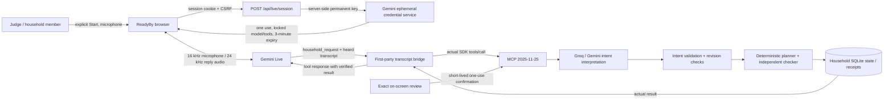

# ReadyBy live voice

Choose **Try the live demo → 2 · Washer delay → Start live voice**. Allow the microphone and say, “The washer has another fifteen minutes left.” Speak normally; there is no wake word. You can interrupt a spoken reply. **Stop voice** closes capture and playback. A session ends after three minutes.

The chapter seeds fictional progress at 08:06; it does not inject the washer report. That spoken request must travel through the real tools before the UI changes. Expected computed result: all work finishes at 08:28; saving flexible laundry for later permits a proposed 08:16 finish for the 08:20 deadline. Say **“yes”** to open the current proposal for review, then choose **Approve this revision**. A voice “yes” never commits a change.

## Architecture

Gemini Live supplies conversational audio, transcription, turn detection and tool requests. The first-party client forwards **the actual input transcription**, ignoring model-supplied arguments. All household effects pass through the existing MCP interpretation and domain validation. The voice model cannot mint a confirmation, press the review button, operate an appliance or observe physical completion.

## Configuration and limits

- Set server-side `GEMINI_API_KEY`. It is independent of `READYBY_AI_PROVIDER`; the hosted beta uses Groq for typed/tool interpretation with Gemini fallback and Gemini Live for audio.
- `READYBY_LIVE_MODEL` defaults to `gemini-3.8-live`. The installed official SDK uses its ephemeral-token Live API path; ephemeral credentials are a preview feature.
- The permanent key stays on the server. The browser receives a single-use credential, starts within 60 seconds, and ends within 180 seconds. Model, instructions and tool configuration are locked when minting it.
- A configured key is not proof of funded quota. A new project may require Gemini API prepayment in AI Studio in addition to Google Cloud billing linkage. The beta temporarily uses the owner's previously supplied credentials with authorization.
- Production reserves at most 60 voice sessions per UTC calendar month, 10 per UTC day and 3 per account per 10 minutes. Failed starts consume reservations conservatively. Text interpretation has a separate 2,000-request monthly allowance. Database-backed counters survive process restarts. These are usage controls, not a dollar spending cap.
- Supported browsers need HTTPS (or localhost), microphone access, AudioWorklet and Web Audio. Declining permission leaves typing and task controls available. Stop, unmount, disconnect and timeout close capture resources; remote interruption stops queued output audio.

## Privacy and demonstration honesty

Audio streams directly from the browser to Google while connected. ReadyBy does not store raw microphone audio. Submitted transcript text, household state and tool receipts are stored in the household database. Provider terms apply to processing; use fictional details for judging. Owners can export/delete household data in Settings. The optional Vosk recorded-transcript feature runs on the ReadyBy server and appears only when installed; it is not needed for live voice.

This is a labelled **Alexa+ web simulation**, with real model inference, real MCP transport and actual checked household state. It is not a native Echo connection or Amazon's proprietary voice. Synthetic speech integration checks are reproducible engineering evidence, not a measurement of human microphone quality, accents, noisy-room performance or large-scale capacity. See [verification](READYBY_0_4_VERIFICATION.md).

Provider reference: [Gemini ephemeral tokens](https://ai.google.dev/gemini-api/docs/live-api/ephemeral-tokens).
