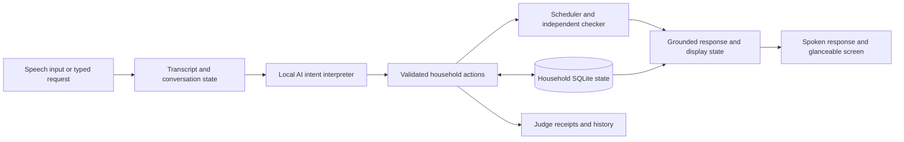

> Historical review of the imagined reference film, not the current product or final submission video. Current testing instructions: [judge guide](JUDGE_GUIDE.md). Contact sheets named below are local work products, not public repository assets.

# ReadyBy film review and Alexa+ simulation direction

Reviewed 23 October 2026. Source: `E:\Codex Projects\ReadyBy-Film-2026\renders\ReadyBy-Product-Demo-1080p.mp4`.

**Recommendation: adopt the film's visual direction and decision hierarchy, then implement them as views of the existing checked household state. Build a clearly labelled Alexa+ experience simulation. The film should guide the product; it should not be submitted as evidence that the depicted software works.**

## Review scope

The supplied MP4 is 150.000 seconds, H.264, 1920 × 1080, 30 fps, with AAC audio. I extracted and visually inspected 17 frames spanning the opening, goal entry, original schedule, progress, disruption, proposal, approval, resumed work, summary and closing. I also read its authored SPEC, REVIEW and relevant animation source to check timing and continuity. This is sampled visual and sequence analysis, not a frame-by-frame motion or listening review. The film specification describes music and click effects, without narration.

The film README explicitly says it is an authored visualization based on a brief and that the application repository was not inspected. I compared it with the current React workspace source, backend/agent source and saved v0.2 audit screenshot. I did not run a new browser or model test for this review. No application behavior was changed.

Extracted evidence: first contact sheet (local historical file: `evidence/film-review/contact-1.jpg`), middle contact sheet (local historical file: `evidence/film-review/contact-2.jpg`), last contact sheet (local historical file: `evidence/film-review/contact-3.jpg`).

## What is strong, and what to bring into the product

| Film moment | Assessment | Implementation decision |
| --- | --- | --- |
| 00:04 opening | Warm ivory, charcoal, restrained amber and green create a calm household identity. More appropriate to the proposed morning experience than the current corporate navy navigation. | Adopt the palette and typography hierarchy. Use existing icon components, responsive layout and accessible controls. Color is accompanied by words and icons. |
| 00:15–00:24 goal | One outcome, one deadline and what can wait are understandable before any schedule appears. | Preserve this structure in conversational onboarding. Extracted tasks, durations, owners and essential flags remain estimates to review before starting. |
| 00:32–00:43 schedule | The dependency between washing and hanging is legible. The deadline line makes the narrow margin visible. | Render real scheduler slots, people and passive release times. Keep an expandable schedule in the desktop workspace; use a simpler next-action summary on the household display. |
| 00:54–01:01 progress | Completed work stays visible. The right panel identifies the next useful action. | Keep completion facts persistent across replans. Do not mark chores complete because time elapsed. Prioritize the next actions over setup controls during execution. |
| 01:18 disruption | The original plan's failure becomes specific: hanging finishes at 08:11 against an 08:00 deadline. | Show the computed full-plan finish and cause. Display where a timing estimate came from. |
| 01:28–01:46 recovery | Proposal and approval are visibly different states; completed work survives both. This is the strongest product sequence. | Show the exact consequence before approval, then record the approved proposal and refreshed state. A delay becomes a fact immediately; deferring work remains uncommitted until approved. |
| 01:55–02:04 continuation | The assistant returns to useful work. Deferred laundry remains visibly unfinished. | Preserve a saved-work notice and an actionable next step. Do not imply that deferral stops a physical washing machine. |
| 02:15 history | The event trail makes the result inspectable. Departure is explicitly unconfirmed. | Present this as an expandable history and judge view backed by persisted events, not an always-visible wall of metadata. |

Useful tokens from the film: canvas `#f4f2ed`, ink `#292b28`, amber `#a16820`, green `#52725c`. Recheck contrast and responsive behavior in actual components; a 1080p animation's fixed 1920-pixel canvas and 248-pixel sidebar are not responsive implementation assets.

## What would weaken a submission

1. **The differentiated moment arrives late.** The changed forecast appears around 01:18; the recovery/approval chapter occupies about 27 seconds. Bring the conflict into the opening 20–30 seconds and spend the saved time proving behavior.
2. **The interaction is mostly pointer-driven.** Typing, tabs and clicking approval demonstrate a desktop planner. For the Alexa+ story, demonstrate natural requests, spoken responses, clarification and spoken approval with an accessible touch/text equivalent.
3. **A precise number appears without a source.** At 01:11 the request is “The washing cycle needs more time.” At 01:18 the estimate is 20 minutes remaining. Show the user saying “20 minutes remaining,” or ask how long. Our current interpreter already blocks an ungrounded numerical change; the demo must respect that guard.
4. **It simplifies away much of the hard work.** The film's five entries and three essential chores conceal the current engine's two-person capacity, overlapping work, independent feasibility check and protected-essential case. Retain the real, stronger fixture in the working demo.
5. **The two scenarios are different.** Film: 07:35 start, 08:00 deadline, five entries, 20-minute washing update. Application: 08:00 start, 08:20 departure, seven tasks, 15-minute washer report at 08:06. Do not mix these times or infer that the film is a skin of our running application. Adopt the visual system while keeping the application scenario canonical.
6. **Automatic appliance language can imply a connection.** Show “User-reported washer estimate” and “estimated ready time.” A running physical process is not evidence of appliance telemetry.
7. **Readiness and business impact need precise wording.** Three reported essentials complete does not prove the family departed. A larger margin after deferral is not proof the same work became faster. The value hypothesis is less coordination effort and fewer missed essentials; customer adoption and business results remain unmeasured.

## What is permitted for Alexa+

The current [official rules](https://amazonappdev2026.devpost.com/rules), Alexa+ repository requirements, explicitly permit a simulated experience built with any AI or agentic tool, with no specific framework, SDK or MCP-shaped surface required. Its source and functioning simulated experience must still be provided. Our local AI and domain-action architecture can use that route.

The [official FAQ](https://amazonappdev2026.devpost.com/details/faqs) says native Alexa+ developer tools are gated to selected partners and participants cannot connect a self-hosted MCP server to an Alexa+ device or developer console. It also permits an actual MCP client implemented as a web page. Therefore an Echo Show-inspired web display is feasible; a claim of native Alexa+ integration is not supported by our build.

If we separately choose the self-hosted MCP route, the rules specify MCP **2025-11-25** or an accepted later version over Streamable HTTP. Our current server uses application REST endpoints; it is not an MCP server. An adapter is an optional interoperability improvement, not a requirement for the permitted simulation route and not something to claim until it actually works.

## The proposed experience

Use one stateful product with two views:

- **Household display:** the film's calm visual language, departure deadline, computed readiness estimate, next actions by person, and one primary decision. Hide account administration and technical receipts during household execution. Keep detailed tasks accessible.
- **Judge inspection:** the real input/transcript, local model identity and latency, validated intent, executed domain action, relevant scheduler result, independent checker outcome, proposal identifier, state revision and saved event. Open on demand without resetting the mission.

Keep a persistent, readable label: **“Alexa+ experience simulation · Local AI · No device connection.”** A device-shaped frame can provide context, but is not the technical integration.

Proposed flow, reusing the current domain engine:

This is proposed presentation/conversation work around an existing engine, not a claim that speech support is implemented. The current app supports typed AI requests and direct controls. Add a local speech recognizer and installed local speech output if the no-service-dependency requirement continues. Verify local availability and accuracy on this machine rather than assuming browser speech recognition works offline. Downloaded models/assets are setup dependencies; the recorded flow should require no external API calls.

Persist a bounded pending clarification, including task and missing field, so “15 minutes” can answer a preceding washer question without guessing its referent. Current single-request interpretation should not be presented as already supporting that follow-up. Use explicit listening, transcript, interpreting, checking, approval and speaking states; the interface must not show completion before the backend commits it.

Build speech from validated state and computed results. Bind approval to the exact pending proposal and expected revision, preserving the existing stale-state and idempotency rules. If household constraints change while approval is being spoken, request review of the updated proposal.

An optional MCP adapter can expose the same authorized domain operations; an actual client must initialize, discover tools and invoke them over the required transport. Preserve household identity, validation and consent checks. Do not merely rename REST receipts “MCP calls.”

## Suggested working conversation

Use the application scenario so all results can be reproduced:

1. “Alexa, help us leave by 8:20.” Show the reviewed seven-task draft and its estimates; confirm before starting. Initial computed finish: **08:19**.
2. Explicitly report actual task progress. If using the seeded 08:06 chapter, label it as seeded rehearsal state, not a live inference that the chores happened.
3. “The washer needs more time.” Ask: “How many minutes are left?” Then: “Fifteen minutes.” The reported release time becomes **08:21** and the full-plan finish **08:28**.
4. Grounded response: “Finishing everything is estimated for 8:28. Saving laundry for later keeps your 8:20 departure. Shall I save it?” Screen: **proposed retained-work finish 08:16**, with unfinished laundry and unchanged completion facts visible.
5. “Yes, save the laundry for later.” Commit only the matching proposal; show its approval event. Confirm that laundry remains unfinished.
6. Continue the next scheduled household actions. A return-home action requires washer readiness confirmation and a new deadline before saved laundry is resumed.
7. In a clearly identified separate test case, make laundry essential. Show that the engine refuses to defer it and only offers a later departure with explicit agreement. This demonstrates constraint handling beyond a generic checklist.

Amazon's [multimodal design guidance](https://developer.amazon.com/en-US/alexa/alexa-haus/multimodal-introduction) supports voice-first core functions, complementary touch, context-sensitive screens, a dominant useful element and readability at a distance. Apply these principles without claiming that this browser screen is an official Alexa+ UI or a deployed APL experience.

## Priority and acceptance

| Priority | Work | Evidence of completion |
| --- | --- | --- |
| First | Film-inspired responsive household view connected to current state | Changing deadline, owner or task duration changes displayed results through the real engine; no authored result screens. |
| First | Clear simulation identity, grounded estimates and approval lifecycle | No device claims; no invented 20-minute estimate; unapproved deferral never commits. |
| First | Working input/response loop and pending clarification | Spoken or typed requests execute the same validated actions; missing duration is collected; errors leave truthful state. |
| First | Honest model latency | Show measured elapsed time and useful busy state. Prior observed 16–24-second AI requests are an unresolved interaction concern. A shorter edited film must disclose cuts; animation does not solve runtime latency. |
| First | Stronger live evidence | A continuous disruption-to-approval segment, persisted result after refresh, and a protected-essential counterexample. Revalidate any new conversation behavior. |
| Next | Voice completeness and distance readability | Core task flow works without reading a screen; local audio works on the demo machine; keyboard/touch alternatives remain usable. |
| Optional | Standards-based MCP transport | Real protocol negotiation, tool listing/calls, authorized state access and reproducible compatibility checks. |

Suggested 150-second submission structure: 0–12 problem and outcome; 12–30 real goal/draft; 30–45 reported or explicitly seeded progress; 45–95 live disruption, clarification and approval; 95–115 essential-task counterexample; 115–138 inspect actual receipts and refresh persistence; 138–150 concise outcome and scope. This is a target edit, not a proven timing budget: measure actual AI and speech latency first and label any elapsed-time cuts. Keep branded intro/outro brief.

The four official judging dimensions are Tech Implementation, Design, Potential Impact and Quality of the Idea. This direction improves Design through clear decision states; Tech Implementation through live calculations, checked constraints and persistence; Quality of the Idea through recovery with consent; and Potential Impact through a concrete recurring household problem. It does not establish customer demand or retention by itself. Our winning argument should be a repeatable, trustworthy demonstration of household recovery, supported by the implementation—not an assertion that a polished film guarantees a shortlist.
