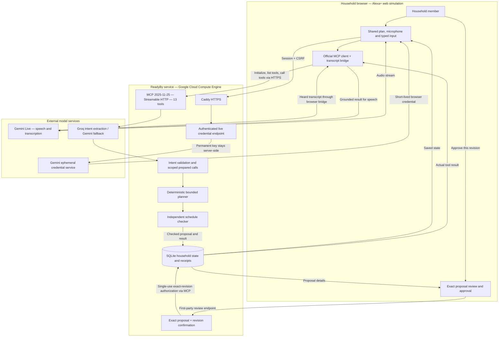

# ReadyBy 0.4 architecture

The current system runs as a React browser application and a Node.js service on Google Cloud Compute Engine, with Caddy HTTPS and persistent SQLite. This diagram describes the implemented logical flow; optional local Ollama/Vosk paths are documented in [setup](../SETUP.md).

Gemini Live supplies conversation; the browser bridge forwards the actual heard transcript to the MCP path. The language model interprets requests. Deterministic planning and checking establish feasibility under the reported estimates. A voice yes opens review; the exact on-screen confirmation authorizes a changed commitment. The app cannot observe or complete physical chores.

Permanent provider keys stay on the server. Microphone audio streams directly to Google during a session. ReadyBy stores transcript text, household state and tool receipts, not raw microphone audio. The MCP endpoint uses household session and CSRF authentication; native Alexa OAuth and Echo connectivity are not implemented. [Voice details](../LIVE_VOICE.md) · [Deployment limits](../HOSTING.md).

## Retained 0.3 architecture evidence

The SVG and matching PNG use the supplied reference's grouped components, orthogonal arrows, navy modules and record cylinder. MCP is implemented. Hosted providers are labelled separately from local speech/storage. This is a logical flow, not a packet trace.

## Source map

| Component | Source |
| --- | --- |
| Live audio, transcript bridge and ephemeral credentials | `frontend/src/components/LiveVoice.tsx`, `src/platform/live.mjs` |
| Browser SDK client, discovery and prepared calls | `frontend/src/mcp-client.ts`, `api.ts` |
| Streamable HTTP and tool schemas | `src/platform/server.mjs`, `mcp.mjs` |
| Shared actions, prepared calls and confirmations | `src/platform/missions.mjs` |
| Hosted/local calls and validated intent | `src/readyby/providers.mjs`, `agent.mjs` |
| Bounded clarification | `src/readyby/conversation.mjs` |
| Rules, scheduler, independent checker | `src/readyby/reducer.mjs`, `planner.mjs`, `verify.mjs` |
| Local speech | `src/platform/speech.mjs`, `scripts/speech-worker.py` |
| Session scoping and persistent state | `src/platform/security.mjs`, `database.mjs` |
| Independent SDK client | `scripts/mcp-demo.mjs` |

Interpretation returns a prepared call; the browser invokes the exact selected tool. Direct controls use the same typed tools without an LLM. Approval obtains a confirmation from the dedicated first-party review endpoint. A model-supplied approval boolean is insufficient. The record arrow summarizes proposal/action transactions; UI reads return saved state to the display and inspection view. Local voice output is omitted from the main request path.

Hosted processing sends text and mission context to the configured provider. Local Ollama is separately selectable. Vosk's dashed path covers local PCM transcription and return for review. Native Alexa onboarding/OAuth, AWS and IntentSeal runtime integration are not implemented. Exact evidence and limits: ../READYBY_MCP_VERIFICATION.md.
